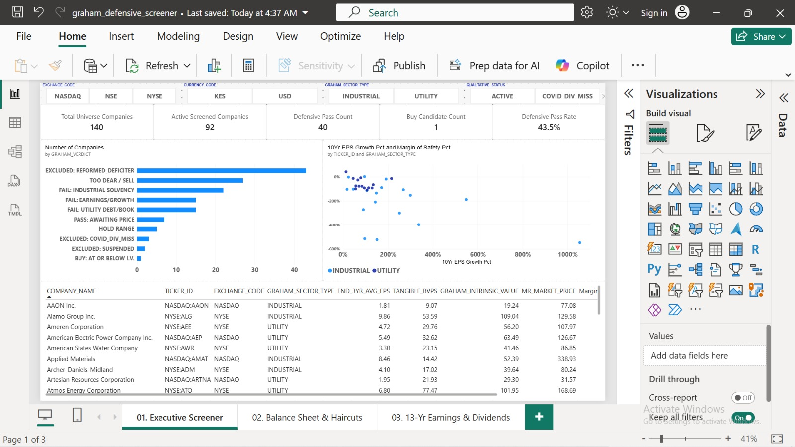
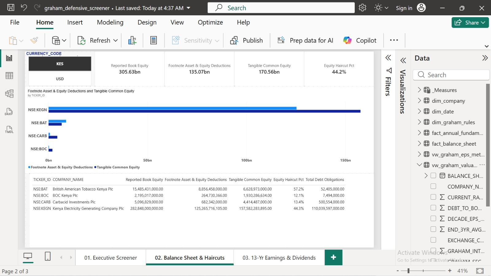
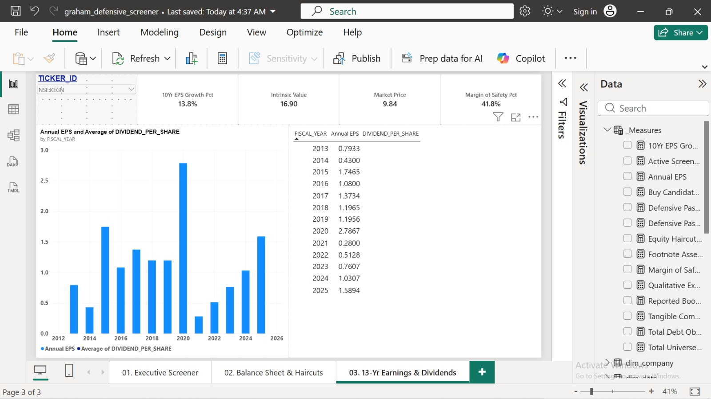
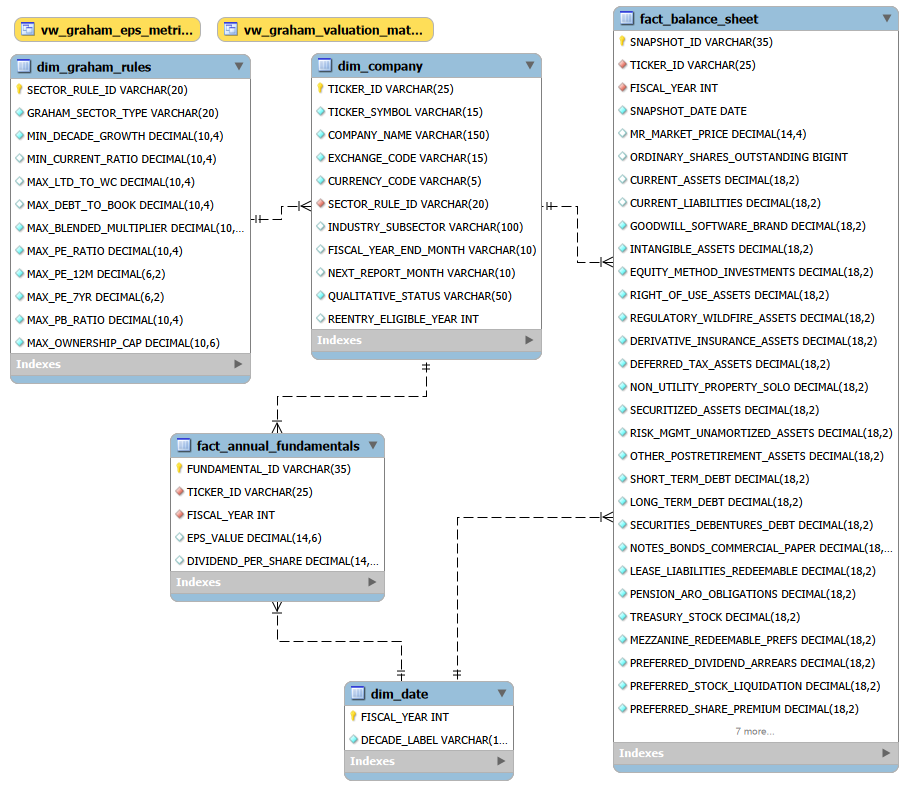

# Benjamin Graham Defensive Equity Screener & Forensic Valuation Engine (NYSE, NASDAQ & NSE)

An end-to-end financial analytics warehouse and semantic Power BI reporting suite implementing Benjamin Graham's quantitative and qualitative defensive investor framework across **140 equities** spanning US markets (`NYSE`, `NASDAQ`) and the Nairobi Securities Exchange (`NSE`) from **FY2013 to FY2025**.

## Executive Dashboard Preview
### 1. Executive Screening & Intrinsic Value Overview

* **Relational Warehouse (`sql_00`–`sql_03`):** Normalized Galaxy Schema (`dim_company`, `dim_date`, `dim_graham_rules`, `fact_annual_fundamentals`, `fact_balance_sheet`) with automated `CHECK` constraints, qualitative eligibility exclusions (`SUSPENDED`, `COVID_DIV_MISS`, `REFORMED_DEFICITER`), and multi-layer analytical SQL views (`vw_graham_eps_metrics`, `vw_graham_valuation_matrix`).
* **Forensic Balance Sheet Adjustments:** Models 23 company-specific footnote deductions—goodwill, intangibles, operating lease ROU assets, deferred tax assets, regulatory assets, and revaluation reserves—to isolate true **Tangible Common Equity (TCE)** and **Tangible Book Value Per Share (TBVPS)**.
* **Declarative Semantic Layer (`tmdl_00`–`tmdl_01`):** 14 governed DAX measures scripted via Tabular Model Definition Language, featuring a `HASONEVALUE` cross-currency aggregation firewall (`USD` vs. `KES`).

## Repository Structure
* `graham_defensive_screener.pbix` — Interactive 3-page Power BI executive dashboard.
* `sql_00_schema_and_audit.sql` — DDL schema, integrity constraints, analytical views (`vw_graham_eps_metrics`, `vw_graham_valuation_matrix`), and audit baseline.
* `sql_01_load_nse_kenya.sql` — Ingestion and forensic balance-sheet adjustments for Nairobi Securities Exchange (`NSE`) equities (`KES`).
* `sql_02_load_nyse_utilities.sql` — Ingestion and statutory utility-rule evaluation for US regulated utilities (`USD`).
* `sql_03_load_nyse_industrials.sql` — Ingestion and defensive industrial-rule evaluation for `NYSE` & `NASDAQ` equities (`USD`).
* `tmdl_00_base_measures.tmdl` — Stage 1 TMDL deployment (base counts, `HASONEVALUE` currency guards, and `AVERAGEX` Margin of Safety).
* `tmdl_01_composite_ratios.tmdl` — Stage 2 TMDL deployment (`ref table _Measures` composite ratios).
